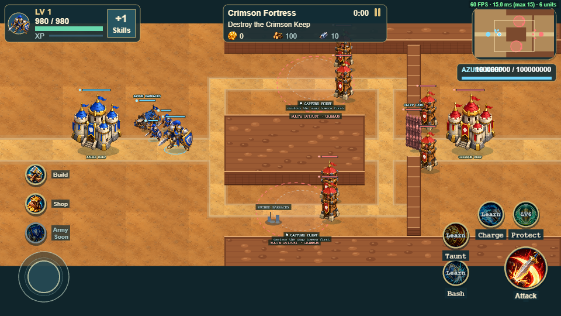

# Chapter 4 M6 — Crimson Fortress (campaign-36)

**Status:** implemented and verified on branch `chapter4/m6-crimson-fortress`, worktree `G:/work/ark/arkhero-chapter4-m6`, based on `main` `c8651c5`. It is uncommitted, not merged, not pushed and not deployed. It is waiting for PO review and a real-device human playtest.

Debug URL: `?debug=1&level=36` or `?debug=1&chapter=4&mission=6`. These are dev-only links; Chapter 4 is still "coming soon" in the menus. Dev server: `npx vite --host 127.0.0.1 --port 5366` (port 5361 was already taken by another worktree's server).

All balance values are provisional until the human playtest. Bot results describe bot behaviour; they are not playtest outcomes.

## The mission

The goal is to destroy the Crimson Keep. There is no M5-style Keep shield, and the outposts are footholds, not keys.

### Map: `crimson-fortress`

The map is a 1920 × 1152 window built from the existing systems.
- **The Crimson Ridge** (x 768–1248, y 432–768) splits the field into two roads:
  - the **Siege Road** (north), past the **North Outpost**;
  - the **Shadow Trail** (south), past the **South Outpost** and its **ruined Barracks**.
- **The sally ground** (x 1248–1392) is the only place the two roads meet, in front of the Fortress wall (x 1392–1440).
- **The Fortress Gate** (1416,600) is the wall's single gate. It is a faction gate: Crimson pass through it, Azure must break it. It has 2500 HP and `assist`, so Azure Barracks soldiers help the Guardian break it.
- Each road has a **Commander spawn at its east end**, (1320,264) and (1320,936), and a **flank waypoint at its west end**. The Commanders never come out through the gate, which removes the shared bottleneck the probe found.
- The two gate towers stand flush behind the wall. They see out only after the gate falls.
- **Art:** the canyon painter, with both roads and the sally ground painted, the Ridge drawn as a mesa and the wall drawn as a wall. The art registry entry is complete; the registry test was not weakened.

### Crimson Commanders

| | Iron Marshal | Shadowblade |
|---|---|---|
| Base | Crimson Hero (833 HP, 80 damage, 23-tick cooldown, speed 95) | same |
| Multipliers | HP 1.6 · damage 1.3 · attack speed 0.8 · move 0.75 | HP 0.8 · damage 0.85 · attack speed 1.4 · move 1.4 |
| Against structures | ×1.5 | ×1 |
| Road | Always the Siege Road | Chosen at each warning (see below) |
| Targets | Nearest Azure tower, then Barracks, on his road or past its west end, then the Keep | The Azure Barracks farthest from the Guardian at the warning; when it is gone, the Keep |
| Escort | 3 soldiers spawned beside him, at his speed, sharing his road and target | none |
| First warning, then out | 84 s, out at 90 s | 129 s, out at 135 s |
| Rest after death | 60 s, then a 6 s warning | 40 s, then a 6 s warning |
| Flank timeout | 40 s (Commander only) | 40 s (Commander only) |
| Look | `crimson-warlord` sprite at 2.3× with an "IRON MARSHAL" nameplate | a lean violet recolour of the Crimson minion at 1.35× with a "SHADOWBLADE" nameplate |

How the Shadowblade chooses its road at each warning:
1. the road its target stands on, if the target is on a road;
2. otherwise the road the Marshal is not on, while he is marching or announced;
3. otherwise the road whose waypoint is farther from the Guardian.

It does not retarget while the Guardian moves.

Attack speed here means `cooldownTicks`, and `windupTicks` is scaled the same way. Commanders also get **6 px of extra melee reach**. Navigation picks attack cells exactly 48 px from the target, and a Commander nudged a pixel off its cell by its escort used to freeze out of reach.

### Forward Barracks

The Azure Barracks cap is 3:
- one stands at the start, at (10,10);
- one more pad is at home, at (10,14);
- the **ruined Barracks** at the South Outpost (19,19) is the third.

The ruin opens when the South Outpost is captured and closes again if the outpost is lost. Its repair costs **48 Wood / 8 Iron** (40%) and takes 5 s, and it counts toward the cap. Its cell is reserved: a tower or wall placed there is refused with *"Ruined Barracks: repair it with a Barracks"*. On the map it shows as "RUINED BARRACKS", and after the capture as "REPAIR BARRACKS · 48W 8I · 5s". The Build panel names the job "Repair Barracks · 48 W · 8 I".

`cellAnchor` is on for M6 soldiers. The probe showed they freeze at the Ridge corners without it.

### Pacing and notices

- **Waves:** the same as M1–M5 (6–8 every 25 s from 10 s). They keep the pressure up while the Commanders rest.
- **Commander attacks** use the existing wave notice channel; there is no new HUD panel:
  - *"Iron Marshal marches down the Siege Road · he breaks towers, then Barracks"*
  - *"Shadowblade strikes from the Shadow Trail · it hunts your South Outpost Barracks"* (or *"… it is going for your Keep"*)
  - *"Shadowblade falls · returns in 46s. Strike now!"*
- **Outpost notices** do not mention a shield. For example: *"South Outpost captured · build here and repair the ruined Barracks"*.
- **The objective plate** always reads *"Destroy the Crimson Keep"*.
- **Last Stand:** when the Fortress Gate falls, 4 Elite Soldiers are released once.

## Architecture: files

| File | Change |
|---|---|
| `src/data/matchSetup.ts` | `MatchCommander`, `commanders` and `campShield:false` overrides with validation; `MatchPost.barracksRuin` (must be a pad of its camp). Camps may share a match with a garrison only when Commanders are present. |
| `src/data/campaignLevels.ts` | `crimsonFortressLevel` (campaign-36), registered after M5 |
| `src/data/combat.ts` | `marshalId`, `shadowbladeId` |
| `src/simulation/Simulation.ts` | Commander schedule, decision, release and escort (`initCommanders`, `decide`, `commanderDue`); rest on death; `commander` events; structure bonus; reach margin; ruined-Barracks repair price and reserved cell; `campShield` off; a faction-gate garrison skips the "sealed area" check; `cellAnchor` for M6 |
| `src/simulation/Movement.ts` | Commander targeting and escort following (one branch in the existing Hero block, one escort block) |
| `src/simulation/Flank.ts` | `flank.timeout` per unit, falling back to the shared `FLANK.timeout`, which is unchanged |
| `src/simulation/GameState.ts` | `Unit.commander`, `Unit.escortOf`, `flank.timeout`, the `commander` event |
| `src/world/battlefield.ts`, `battlefieldArt.ts` | The `crimson-fortress` battlefield and its art |
| `src/world/commanderAppearance.ts` | Commander scales and the Shadowblade's violet recolour |
| `src/scenes/Battle.ts` | Commander sprites and nameplates; drawing the ruined Barracks and its label |
| `src/scenes/HUD.ts` | Commander notices; outpost notices without a shield; the objective plate |
| `src/ui/BuildPanel.ts` | The "Repair Barracks" heading |
| `tests/campaign-level-36.cjs` | 14 focused tests |
| `tests/support/fortressBot.cjs` | Bot for plans *defend*, *ignore* and *rush* |
| `scripts/verify-crimson-fortress.mjs` | Browser walkthrough: 27 checks, 10 stills |
| Six existing tests | Updated lists of registered Chapter 4 levels and battlefields only (campaign-36, `crimson-fortress`) |

No AI framework was added. M1–M5 data and balance are untouched, and the save format is unchanged.

## Verification

- `tsc` clean. `npm run build` green (only the usual chunk-size warning).
- Full suite: **1165/1165**.
- Browser, dev server on 5366, Chrome with swiftshader:

  | Script | Result |
  |---|---|
  | verify-crimson-fortress (M6) | 27/27 |
  | verify-fortress-approach (M4) | 29/29 |
  | verify-canyon-basin (M5) | 25/25 |
  | verify-mobile-landscape | 62/62 |
  | verify-river-island (M3) | 15/15 |
  | verify-cliff-pass (M2) | 22/22 |
  | verify-forest-edge (M1) | 31/31 |
  | verify-objective-hints | 40/40 |
  | verify-achievements | 37/37 |

  Regression stills were written to the session scratchpad, so tracked screenshots are unchanged.

Stills are in `docs/screenshots/crimson-fortress/`:
1. overview
2. South Outpost captured
3. ruin selected
4. ruin repaired
5. Marshal out
6. Shadowblade out
7. both roads
8. Last Stand
9. phone capture
10. phone warning

## Bot trials (headless, deterministic, final values)

| Plan | Variant | Result | Time | Azure Keep HP | Guardian deaths | Structures lost to Commanders | Gate falls |
|---|---|---|---|---|---|---|---|
| defend | default (third Barracks) | win | 334.6 s | 3000 | 3 | 5 | 165.6 s |
| defend | no ruin | win | 408.5 s | 3000 | 4 | 8 | 227.3 s |
| defend | no second, no ruin | win | 412.6 s | 3000 | 4 | 11 | 227.3 s |
| defend | North Outpost first | win | 451.4 s | 3000 | 4 | 7 | 183.3 s |
| defend | one home tower | win | 313.8 s | 3000 | 2 | 7 | 106.9 s |
| ignore | default | win | 305.5 s | 1028 | 3 | 7 | 163.4 s |
| ignore | no ruin | win | 354.3 s | 3000 | 3 | 6 | 224.7 s |
| ignore | no second, no ruin | loss | 425.6 s | 0 | 4 | 14 | 224.7 s |
| ignore | North Outpost first | loss | 349.2 s | 0 | 4 | 8 | 181.1 s |
| ignore | one home tower | win | 262.1 s | 1892 | 2 | 7 | 106.9 s |
| rush | every variant | loss | 164–229 s | 0 | 2–3 | 2–7 | — |

- **Pacing:** *defend* wins in every variant in 314–451 s (5.2–7.5 min). That is the 6–7 minute guide; human time is expected to be longer.
- **The third Barracks** is useful but not required. *defend* wins about 74 s sooner with it, and still wins without it.
- **Commander behaviour:** in every run each Commander keeps to its own road. The Marshal's escort stays within 200 px until first contact. **No Commander, escort or soldier stood idle for 10 s** in any run (the bot's navigation watch, which excludes soldiers waiting at the 400 px leash).
- **Downtime:** both Commanders are down 53–68% of the time after 2:30. In those windows the Guardian's damage on the fortress is 2–10× higher than when one is up. For example, the default *defend* run deals 40.9 per second against 14.3.
- **Last Stand:** 4 Elites in every run where the gate fell.
- **Rush always loses.** With nobody home, the Commanders, waves and escorts break the Azure Keep. Ignoring the Shadowblade sometimes wins and sometimes loses.

## Shadowblade pressure on the Keep when no Barracks stand

**Yes, and it is strong.** With every Barracks gone, the Shadowblade's warning names the Keep. Measured with the Guardian away at the fortress and two home towers at (12,9) and (12,15):
- It strikes the Keep's north-east corner. Only one of the two towers reaches it (525 damage).
- It survives with 141 HP and **destroys the full 3000 HP Keep 43 s after its warning**.

In the bots it dealt 952–2,856 Keep damage in *ignore* and *rush* runs.

A Guardian who answers in time stops it. It strikes about 15 s after its warning; the Guardian's travel time from the fortress is about 4–5 s. Still, a single unanswered attack ends the match. That is the M1 finding "a Hero marching on the Keep is too punishing" in a new form.

Levers if the PO wants it softer:
- a Shadowblade multiplier below 1 against the Keep only (0.5 halves the damage);
- an armed Azure Keep for this mission;
- in the briefing, telling players to keep a Barracks standing as bait.

## Known limitations

- Bot times are deterministic. Crit seeds do not vary them; only plans and variants do.
- The art uses the canyon palette. The Ridge, wall and spawns read well in stills, but there is no new fortress art.
- The Shadowblade is a recoloured minion and the Marshal a scaled Warlord. There are no new animations.
- Commanders spawn in the open sally ground, so a Guardian waiting there can meet them as they appear (spawn-camping). The rest timers make that a time cost, not an exploit, but humans may try it.
- The Commanders' extra 6 px of reach applies to Commanders only. The general case (any unit whose attack spot is exactly `range` away) is a latent engine issue and was left alone.

## Recommended human playtest scenarios (real device)

1. Play blind with no instructions: time to win, deaths, whether both warnings are read in time, and whether the Marshal and the Shadowblade are told apart at a glance on a phone.
2. Ignore the ruined Barracks for the whole match: is the mission still winnable and still fun?
3. Repair the ruin early, then defend it from the Shadowblade: is the warning enough time to intercept?
4. Push the gate right after a Commander falls ("returns in Ns"): does the window feel real?
5. Let every Barracks fall, then leave home: is losing to a lone Shadowblade fair (see the levers above)?
6. Phone landscape (844×390 class): notices, nameplates and the ruin label must be readable.

## Pre-playtest adjustment (2026-11-03): Shadowblade damage against the Azure Keep

PO decision: GO for human playtest preparation; merge on hold.

One balance change was made. The Shadowblade now deals 0.5× damage to the Azure Keep only, through a new `MatchCommander.keepBonus` (set to 0.5).

Unchanged: its damage to Barracks (still ×1), its movement, its flank road, its target choice and its warning. The Iron Marshal keeps ×1.5 against the Keep. Tests assert each hit: 68 damage to a Barracks and 34 to the Keep.

A lone Shadowblade against a full 3000 HP Azure Keep, with no Barracks standing and no Guardian:

| Home towers | Warning → first strike | Warning → result | Before (×1) |
|---|---|---|---|
| none | 14.7 s | Keep destroyed at **61.6 s** (46.9 s of striking) | Keep destroyed at 38.2 s |
| two, at (12,9) and (12,15) | 14.7 s | the Shadowblade dies at 46.0 s; the Keep survives on 994 HP | Keep destroyed at 43.6 s |

61.6 s is a little under the 65–85 s guide. Lowering `keepBonus` to 0.45 would give about 67 s, and 0.4 about 73 s. The value stays at 0.5 as instructed until the playtest.

**Interception.** The Guardian starts at a representative spot and answers the warning after 0, 6 or 12 s (bot harness, basic attacks, two home towers). In every case the Shadowblade dies 14–20 s after its warning. The Keep loses 0 HP when the Guardian answers at once, and at most 374 HP when he answers 12 s late. Interception therefore remains possible. It is still meaningful, because it pulls the Guardian off the front or the fortress for a round trip of about 15–20 s.

**Bots.** With identical options, *defend* times are unchanged (334.6 s default, 408.5 s without the ruin). The other plans:
- *ignore* now wins "North Outpost first" (429.6 s; it lost before) and takes about half the Keep damage from the Shadowblade.
- *rush* still loses, now mainly to waves, the Marshal and the escort.
- No unit stood idle in any run.

**Verification:**
- `tsc` clean, production build green.
- Full suite **1166/1166**, with one new test for the Keep-only multiplier and the warning-to-destruction window.
- Browser: M6 27/27, M5 25/25, mobile landscape 62/62.
- M4 (`verify-fortress-approach`) failed one check, "repair converts it to Azure at full hit points", in 2 of 3 runs. Clean `main` passed it 3/3. With the Battle scene paused, both this branch and clean `main` pass 3/3. So the failure comes from the script, which leaves the real game loop running between its manual steps; it is not a gameplay change. The script was left as it is.

**Preview** (playtest build: `VITE_PLAYTEST=1`, which opens every mission):
- deployment `dpl_7iRn2uX6MryJkxUYLU3CetayNh5X`, target `preview`
- URL `https://kingdom-clash-ggn7o29tp-patipan-kongsirikuls-projects.vercel.app/?debug=1&level=36`

It is protected by Vercel login (302 without one), as earlier previews were. Its bundle (`index-B81GyUre.js`) contains `campaign-36`, `crimson-fortress`, the Shadowblade texture, `keepBonus:.5` and the playtest unlock. The temporary `vercel.json`, `.vercelignore` and `.vercel` link were removed, and `.gitignore` was restored. Production was not touched.

## Human playtest and balance freeze (PO, 2026-11-03)

Two human attempts on the Preview above:
- Attempt 1 was lost after about 4 minutes.
- Attempt 2 was lost after about 11 minutes, with the Crimson Keep down to about 10–15% HP.

The PO judged the difficulty challenging but acceptable for the Chapter 4 finale. **M6 balance is frozen as committed.** No Commander nerf and no change to starting resources, structure HP or the Barracks count.

If player feedback calls for it later, the fallbacks in order are:
1. more starting resources;
2. two starting Barracks.

Allied recruitable Heroes belong to Chapter 5.
