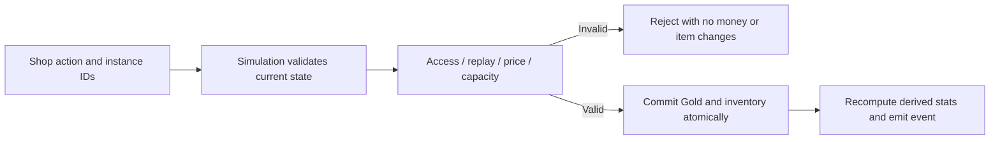

# Phase 3 — Inventory and Artifacts design

12 October 2026 · Baseline `d32d28a43c204ea86e4974e2828952ee7d1dc015` · **Design approved for incremental implementation.** See the Phase 3A scope record below and [foundation implementation report](PHASE_3A_ARTIFACT_FOUNDATIONS.md). Phase 3 implementation scope is complete with seven playable artifacts; see the closure decision and manual playtest below.

Recommend six match-local equipment slots with automatic equipment, Gold purchases and explicit selling/Fusion. Start playable content with Iron Sword and Guardian Shield; expand the specified catalog only when each effect works and its missing rules are approved. Do not add a backpack, item drops, rarity tiers or permanent progression.

The current task calls this Phase 3. The original [09 roadmap](09_ROADMAP_ACCEPTANCE.md) places Artifacts in Phase 2 and Campaign in Phase 3. This document follows the requested numbering without claiming Campaign, three playable heroes or the rest of the original prototype are complete.

## Phase 3 milestone closure — 12 October 2026

Implementation scope is complete at `b0dcf4ca4a82cf8f83e50e6f4e3e536b07b84fd3`: Iron Sword, Guardian Shield, Ruby Gem, Flame Blade (including Fusion), Builder's Crown, Siege Hammer and Commander Banner are playable. **Option A approved:** Arcane Core is deliberately deferred until a future hero meaningfully consumes Magic Power and separate activation/balance approval is granted. This is a product boundary, not an implementation failure or completion of all original eight live products.

Core retains original550 Gold, Magic Power+30 and CDR10% metadata. C4-A preserves pure additive30 power per copy, additive1000 CDR basis points capped4000, accepted-cast integer cooldown snapshots and authoritative HUD reads. Guardian effects remain rank-only; Core cannot be bought/sold and has no live Shop page. No CDR-only Guardian release, power coefficient, new hero or Phase4 is authorized by closure. Original numbered specifications remain unchanged.

Next checkpoint: natural full matches using the [manual checklist and reusable log](PHASE_3_FULL_MATCH_PLAYTEST.md). Implementation closure does not claim human-tested pacing or final balance; record findings before proposing changes.

## 1. Specification traceability

**S** = explicitly specified in original documents; **I** = implemented at the baseline; **M** = missing/incomplete; **P** = recommendation requiring approval. Original numbers in document 03 are explicitly starting values for balance testing, not final balance. Later approved Guardian/Phase 2D decisions are integration constraints, not replacements for original artifact requirements.

| Source | Explicit requirement / limit | Repository status | Phase 3 treatment |
|---|---|---|---|
| [01 — Rules and loop](01_GAME_DESIGN.md) | Start each match at LV1; artifacts/resources do not cross matches. Buy/combine artifacts during play. No permanent replay power. | **I:** match-local hero/resources and Restart. **M:** artifacts. | Preserve match-local ownership; no inventory save system. |
| [02 — Death/respawn](02_HEROES_COMBAT.md) | Retain artifacts, Gold, XP and ranks through death. Buy while dead; shop distance applies to living heroes only. Respawn at full HP with temporary protection. | **I:** death/progression/resources/protection. **M:** artifact retention/trading. | Inventory belongs to stable hero identity, not a particular life ID. Dead buying must bypass the living-hero command gate. |
| [03 — Shop](03_ECONOMY_ARTIFACTS.md) | **Six equipment slots**; living purchases near the base, or purchases while dead; resale **60% of total price paid**. | **M:** slots, purchase access, selling, item paid-cost record. | Six slots, no additional storage. Shop radius and selling access are unspecified and require approval. |
| [03 — Catalog/Fusion](03_ECONOMY_ARTIFACTS.md) | Eight named artifacts below; Flame Blade recipe, missing-component pricing, atomic consumption/payment/output, instance IDs, capacity after consumption, acyclic recipes. | **M:** all item definitions/effects/transactions. | Retain the catalog and recipe. A limited initial catalog is staged delivery, not a replacement artifact design. |
| [03 — Economy/passives](03_ECONOMY_ARTIFACTS.md) | Gold for artifacts; Wood/Iron for construction/army/upgrades. Initial 250/180/30; minion Gold15. Same-named economic unique passives do not stack. Engineer/Crown factors multiply, then round up once. | **I:** initial funds, Wood2/s, Iron0.25/s, minion Gold15, construction. **M:** mines, siege/boss rewards/types, item discounts. | Reuse Gold and existing resource ledger. No new currency, passive Gold income or artifact rewards. |
| [05 — System unlocks](05_CAMPAIGN_FREEPLAY.md) | Basic artifact purchasing from Campaign stage3; Fusion stage8; selected systems available in Free Play. | **M:** Campaign/Free Play/system unlock state. Extended/prototype are test encounters. | A temporary extended-encounter shop capability needs explicit approval; do not relabel it as stage3 or Free Play. Preserve future stage gates. |
| [06 — Time/input](06_MOBILE_UI.md) | Single-player Build/Shop use **0.25 timeScale**; Pause0; restore from state, no multiplied scales. At least48 CSS px targets; pointer ownership/consumption and cancellation. | **I:** Build slowing, shared clock, three pointers, safe-area controls. **M:** reachable Shop. | Shop continues combat at quarter speed; no new pause mode. Preserve Phase 2D geometry and 24px bottom reserve. |
| [07 — Architecture/data](07_PHASER_ARCHITECTURE.md) | Inventory in GameState, UI sends commands, atomic BuyItem, duplicate protection, 30Hz shared timers; validate IDs/costs/recipe graph before play. | **I:** commands/events, deterministic clock, construction/reward ledgers. **M:** item state/commands/validation. | Headless item/stat/transaction modules; no Phaser timers for effects. |
| [09 — Acceptance](09_ROADMAP_ACCEPTANCE.md) | Buy/sell/Fusion, double-tap safety, full inventory Fusion when components free space, insufficient funds/components leave state unchanged; correct Build→Shop time handling. | **M:** item acceptance cases. Existing construction/clock tests are reusable. | These remain required for the completed artifact milestone, even if initial playable purchases precede Fusion. |
| [10 — Implementation scope](10_IMPLEMENTATION_PROMPT.md) | Six-slot artifacts with Fusion; data-driven systems and honest device-test claims. | **M:** artifacts and wider prototype features. | No assertion that an inventory slice completes the entire original prototype. |

**Not specified:** rarity, equipment categories restricting slots, backpack capacity, separate equip/unequip actions, duplicate ordinary-item limits, shop radius/LOS, selling/Fusion access radius, crit multiplier/RNG, magic-power scaling, CDR stacking/cap, Banner radius, Burn damage type/target mask/source ownership. Recommendations below must not be treated as inherited rules.

## 2. Current implementation audit

| Area and source | Existing implementation / reuse | Integration risk or missing function |
|---|---|---|
| [GameState](../src/simulation/GameState.ts) | Serializable units, structures/bases, hero progression, Gold/Wood/Iron, match phase, skills. | No inventory, items, crit/power/CDR, item command or transaction event. Do not hide ownership in Phaser sprites. |
| [Guardian stat refresh](../src/simulation/GuardianSkills.ts), [base combat data](../src/data/combat.ts), [approved growth](../src/data/guardian.ts) | LV1 HP1200, ATK80, armor20; per level +60/+3/+1. Fortitude adds5% of growth-only HP and3 armor per rank, LV18/20. Near-base armor5 and strongest zone armor. HP changes preserve HP fraction, rounded down to two decimals. | `refreshStats()` repeatedly rewrites maxHP, damage and armor. Incrementing these directly on purchase would be erased or compounded. Central derived stats are necessary. Existing minion `baseArmor` caching must not capture an item/aura bonus. |
| [Combat](../src/simulation/Combat.ts), [damage/death flow](../src/simulation/Simulation.ts) | Range/LOS/teams; ordinary strikes with windup/cooldown. Physical/magic damage use `raw*100/(100+max(0,armor))`; direct bypasses armor and shields. Actual HP loss, mitigation/absorption and source IDs are emitted. | No crit roll, Burn processing, structural item multiplier or power scaling. Hook effects into authoritative strikes/hits, not visual `attack` flashes; those precede ordinary strike resolution. |
| [Progression](../src/simulation/Progression.ts), [XPRewards](../src/simulation/XPRewards.ts), [progression data](../src/data/progression.ts) | LV1 point,20-point budget, fixed gates and level thresholds. Positive damage participation/LOS proximity sharing; minion XP60, completed enemy tower XP80; no tower Gold reward. | Preserve XP quantities, gates and life-based reward dedup. Burn source attribution must eventually use this pipeline without awarding extra XP/Gold on repeated death. |
| [Economy](../src/simulation/Economy.ts), [building data](../src/data/buildings.ts) | Private balances in **1/120 resource units**, public state mirrors; atomic validated construction, sequential income ticks and once-only Gold15 rewards. Wall25 Wood; tower80 Wood/10 Iron. | No Gold spending/refund API. Changing `state.gold` alone would diverge from private balances and be overwritten. Item transactions must share the authoritative ledger. |
| [HUD](../src/scenes/HUD.ts), [UtilityButton](../src/ui/UtilityButton.ts) | Shop art and illustrative panel strings exist. `unavailable` blocks both Shop/Army input and shows Soon. A1 allocation, A2 gestures, B1/B2 danger and B3 bounded advice are implemented. | Shop is **not currently usable**. `showUtility()` contains a0.25 Shop branch but it is unreachable through the button. Build-only input gating cannot be assumed to protect a new Shop sheet. |
| [Layout](../src/ui/controlLayout.ts), [main](../src/main.ts), [CSS](../src/style.css) | 960×540 FIT inside safe areas, at least48px utility/skill hits, independent pointers, three active pointers,24px bottom reserve, shared aim-cancel coordinates. | 844×390 provides only about244 CSS px below current top-HUD clearance and above the reserve. A full catalog plus six slots plus details will not fit simultaneously. |
| [Lifecycle/commands](../src/simulation/Simulation.ts), [Battle](../src/scenes/Battle.ts), [Clock](../src/simulation/Clock.ts) | New Simulation on Restart; terminal results freeze rules; death retains progression, replaces life identity; background/portrait pauses; shared30Hz tick,100ms delta cap,5-tick catch-up. | `clearHeroInput()` currently retains only place/learn commands. The dead-hero gate allows place but would skip new buy/sell commands unless handled earlier. New pending trade commands must not survive cancellation/Restart accidentally. |
| [Statuses](../src/simulation/Statuses.ts), [tests](../scripts/test.mjs) | Stun/slow/taunt and shields, headless CommonJS-transpiled Node tests, focused file selection, Playwright rendering checks. | Burn is absent. No deterministic combat RNG exists. Existing sample tests mentioning unaffordable “purchases” exercise construction, not an item shop. |

Some README/LIMITATIONS descriptions are historical and still call utilities preview panels. This audit follows current executable code and the approved Phase 2D reports; no existing artifact implementation was found.

### Baseline budget and meaningful choices

The [extended schedule](../src/data/encounters.ts) has66 scheduled enemy minions. With Gold15 per defeat and starting250, **1,240 Gold is an upper bound**, assuming all die before the match ends. There is no current Gold mine income, siege/boss reward or tower Gold. Earlier victory lowers the amount available.

Saving for Shield500 requires17 minion defeats without another purchase. Buying Sword200 first leaves50 and requires30 total defeats to afford Shield as well. Blade650 + Shield500 needs60 defeats. Six advanced artifacts are not realistically a normal full build here. Do not invent income or increase waves to make all slots fill; use labeled test fixtures for full inventories and late effects, and review normal-match purchase pacing separately.

## 3. Proposed inventory and artifact mechanics

### Ownership and equipment — P, except six slots and lifecycle retention are S

- Six ordered slots, each empty or holding one owned instance. **All occupied slots are equipped automatically**; no second backpack, dragging to equip, body-part restrictions or consumable/active-item buttons. Original “equipment slots” supports this minimal interpretation, but automatic equip is a recommendation.
- Purchases create an instance in the first empty slot after validation. Ownership is stable Guardian ID + match session; instance IDs use a deterministic sequence, never timestamps/random UUIDs. Death retains instances; respawn uses derived full maxHP. Restart starts empty with original resources/LV1. Match end freezes inventory for inspection/results, cancels pending input and rejects trades; new match discards the old state.
- Inspect anywhere through Shop's Equipment view. No standalone unequip toggle in the first version. Replace by explicitly selling an instance or consuming exact instances through Fusion. **Never auto-sell a full-slot item** or silently destroy an item when buying. Selling has a confirmation with refund and stat loss; buy/Combine need one explicit action, not a popup for every purchase.
- Allow duplicate ordinary items initially, additive flat stats; do not invent a universal uniqueness rule. Same-named **economic** unique passives do not stack as specified. Duplicate auras/CDR/crit require the separate decisions below. Six Shields/Swords are a test/balance risk, not a reason to silently change capacity or the catalog.
- Recommended trade access: living Guardian within240 world units of the **own living Keep footprint**, with LOS, or dead Guardian with distance bypass. Range240 and LOS are **P**, borrowed from existing near-base geometry rather than claimed as original shop rules. Apply the same access to buy/sell/Fusion to avoid instant remote trading; only living-buy distance/dead-buy permission are **S**. Browse outside range with a clear disabled action, e.g. “Return to Azure Keep.” Revalidate at command execution, not UI-open time.

### Original catalog — S starting values; all effects currently M

| Artifact | Gold total | Explicit original effect | Delivery / unresolved detail |
|---|---:|---|---|
| Iron Sword | 200 | ATK+15 | First playable catalog; ordinary attack damage, not an invented skill-ATK coefficient. |
| Ruby Gem | 150 | Crit+10% | Needs deterministic crit semantics/multiplier. Required Flame Blade component. |
| Flame Blade | 650 | ATK+35, Crit+10%, on-hit Burn5 damage/s for3s, refreshed | Sword200 + Gem150 + fee300. Crit/Burn must actually work before it is purchasable. |
| Guardian Shield | 500 | HP+250, armor+15 | First playable catalog; preserve HP fraction on stat changes. |
| Arcane Core | 550 | Magic power+30, cooldown reduction10% | No power scaling exists for Guardian. CDR rounding/stacking and power usefulness require approval; do not silently boost skill damage or change damage types. |
| Builder's Crown | 450 | Construction cost reduction8% | Economic unique passive. Apply to authoritative construction costs, not HUD prices alone. |
| Commander Banner | 600 | Troop ATK+15% within an area | Radius, LOS, eligible troops, duplicate aura and death behavior unspecified. |
| Siege Hammer | 550 | ATK+20, building damage+25% | Confirm target/effect mask and duplicate multiplier. Preserve active skills' unit-only targeting. |

No rarity tiers or restricted equipment categories are specified. UI grouping “Basic components / Advanced artifacts” is only proposed navigation, not rarity or a new progression ladder. Fusion is the specified upgrade path; no item XP, enhancement ranks, durability or additional recipes.

### Stat composition and stacking — approval needed for item integration

Recommended single calculation, preserving approved Guardian behavior when inventory is empty:

`maxHP = (1200 + 60*(LV-1)) * (1 + .05*FortitudeRank) + sum(itemHP)`

`ATK = 80 + 3*(LV-1) + sum(itemATK)`

`armor = 20 + (LV-1) + 3*FortitudeRank + sum(itemArmor) + existingBasePassive + strongestExistingZoneArmor`

Fortitude's approved HP multiplier explicitly excludes item/aura HP; do not multiply Shield's250 by Fortitude. No equipment XP/level gate is specified; recommend eligibility based on shop access, supported catalog, funds and capacity only. Preserve level thresholds, skill ranks, ability ranges, base rank damage and respawn protection.

On maxHP changes, preserve the current HP fraction using the existing two-decimal downward policy; HP0 stays0. No full heal on buy/sell, no level rollback. Repeated recomputation must be idempotent and buy→sell cycles must not increase the original HP fraction. Respawn fills the newly derived maxHP. Existing R shield amounts and cap formula remain unchanged unless separately approved.

For later effects, these are **P**, not hidden defaults:

- **Crit:** recommend additive chance in basis points, bounded0–100%,2× ordinary-strike raw damage before armor. Seeded, simulation-owned RNG with seed/state in match state; one draw per valid resolved basic strike, stable unit order, no draw for failed target/LOS/protection or duplicate commands. Skills and Burn never crit. Define shield-absorbed valid strikes as consuming a roll consistently. No `Math.random()` in the rule path.
- **Burn:** recommend only positive-HP-loss basic hits against living hostile units trigger it; magic damage, ticks at30/60/90 after application,5 per tick before mitigation,3s expiry. Refresh extends expiry without restarting the next scheduled damage tick, so rapid attacks do not postpone Burn indefinitely; process a due final tick before expiry, with no immediate tick0 damage. Reapplication uses the stronger same-named Burn and never creates unlimited parallel stacks. Define a deterministic source/tie rule; recommend a landed source persists through its owner's death, clears on target death/respawn and cannot attach to a reused life. No recursive proc from Burn and no crit on ticks. **Structural Burn eligibility and source-death behavior need approval**; source text does not resolve them.
- **Arcane Core:** recommend additive CDR, provisional40% cap, `ceil(baseRankCooldownTicks*(1-CDR))`, minimum1 tick. Snapshot on the next accepted cast; existing readyTicks, windups, shared cast lock and status durations do not change when buying/selling. The cap/rounding are new decisions. Recommend retaining Guardian's rank-only damage initially and withholding Core from its live catalog until its power semantics are approved: either explicitly disclose that power has no Guardian scaling while CDR works, or approve separate skill coefficients. Do not repurpose magic power as ordinary ATK or invent mana.
- **Crown:** named passive once; Guardian costs `ceil(baseResourceCost*.92)` per positive resource amount, then convert to ledger units. Preserve a genuinely zero resource component. Future Engineer factor follows the specified `ceil(baseCost*.9*.92)`, rounding once after both factors; Engineer itself is out of scope. Example current tower becomes74 Wood/10 Iron, Wall23 Wood. Record the actual construction charge for future repair/demolition accounting instead of assuming list price; those operations themselves remain deferred. Recommend Crown remains applicable while dead because base management remains available; this lifecycle choice needs approval.
- **Banner (historical recommendation, superseded by approved C3 policy above):** recommend living-owner aura,240 world radius, LOS, allied living minions only, strongest same-named Banner once across owners; no Guardian/tower buff. `troopATK = baseTroopATK*(1+.15)` without compounding per tick; fractional raw damage passes through the current damage pipeline. These radius/mask/stack/lifecycle details need approval.
- **Hammer:** recommend25% ordinary physical attack bonus against enemies in authoritative structures/bases, including Keeps, not based on sprite/position. Flat ATK adds normally; named structural percentage applies once, not once per duplicate Hammer. No extension of Q/E to structures. The percentage mask/duplicate policy needs approval.

Keep cast rank snapshots and existing rules. Future power-dependent effects need explicit stat snapshots at acceptance, so equipment changes during windup cannot silently rewrite an already accepted effect. Skills without such scaling keep existing damage data. Aura/stat recomputation must use immutable base values rather than repeatedly buffing already derived values.

### Economy, resale and Fusion

Artifacts are **purchased with Gold**, not random drops or kill rewards. Gold earnings remain unchanged; Wood/Iron are not artifact currencies. Crown changes construction costs only, not item prices. Nothing requires a new loot, crafting-station or reward system; implementing the explicitly specified Fusion recipe does not authorize a broader crafting system.

Retain paid-cost basis on each owned instance. Flame Blade quote uses selected owned component IDs, missing component list and remaining Gold; virtual missing components require no temporary inventory slots. The final instance records consumed instances' paid basis plus newly paid Gold, not only the combining fee.

| Owned valid components | Gold due now | Slots after purchase at occupancy6 | Blade paid basis with original prices | Resale |
|---|---:|---:|---:|---:|
| None | 650 | 7 → reject | 650 if capacity allows | 390 |
| Sword | 450 (Gem150 + fee300) | 6 → allowed | 200+450=650 | 390 |
| Sword and Gem | 300 | 5 → allowed | 200+150+300=650 | 390 |

The specified missing-component purchase is allowed when Gold covers it; reject when the remaining price cannot be paid, not merely because a component is absent. Reject wrong-owner, repeated, stale or wrong-definition instance selections. Consumed component modifiers disappear and result modifiers replace them: Blade gives35 ATK/10% Crit, **not** Sword15 + Gem10% + Blade35/10% together.

Resale is60% of the actual acquisition path's recorded paid basis. With integer-Gold catalog prices and the existing1/120-unit ledger,60% is exact (`paidUnits*3/5`); no new whole-Gold rounding rule is necessary. Prior purchases that were already sold are not included again in another instance's basis. Never refund components twice or permit profitable buy/sell/Fusion cycles.

## 4. Data and integration architecture — P

Proposed modules, not files implemented by this investigation:

| Responsibility | Proposed data/module | Integration |
|---|---|---|
| Static catalog/rules | `src/data/items.ts`, catalog validation, shop rules/capability data | IDs, exact original prices/modifiers, effect IDs, recipe component quantities/fee, supported-feature flags. Positive finite bounds, integer costs/ticks, unique IDs, resolvable components, no recipe cycles, coherent total650. |
| Ownership | `GameState.inventory` or a hero-ID-keyed inventory record | Six slot IDs plus instance records `{id, definitionId, ownerHeroId, paidGoldUnits}` and deterministic sequence/version. One source of truth; no save repository. |
| Derived stats | Pure `HeroStats`/item aggregation | Separate level/Fortitude base, equipment totals and temporary aura/passive terms. Delegate existing `GuardianSkills.refreshStats()` rather than introducing a competing writer. Empty equipment must reproduce the approved baseline exactly. |
| Quotes/transactions | Headless `Inventory`/transaction planner + existing `Economy` | Validate immutable candidate state, then commit funds and inventory together. Use private authoritative balances; do not debit public mirrors separately. Instance/transaction ledgers and current quote/version checks prevent replay/stale UI. |
| Commands/events | Extend current unions | Buy/Combine/Sell carry request ID, match session and exact component/item IDs; caller cost is not trusted. Accepted/rejected events include transaction ID and authoritative result/reason; no UI-side inventory/stat mutations. |
| Effects, later | Combat modifier hooks, Burn status, deterministic RNG, aura aggregation | All damage through `Simulation.hit()` and existing reward/death events. Separate basic-strike origin from skill/dot origin so modifiers cannot apply recursively. |
| Presentation | Dedicated compact Shop/equipment sheet + existing utility entry | Read quotes/state; pending actions own their pointer/request; use existing notification priorities and materials. |

Use the current command-phase order deliberately: handle item commands before the dead-hero movement/attack gate, recompute changed stats before cast acceptance, then run existing movement/skills/strike/damage/economy/objective order. Two different legitimate purchases execute in declared command order and may compete for the same funds/slot; replaying one request must not commit twice. A new request after a rejected attempt is distinct, but an old-session request must never operate on a restarted match. UI reuses the same ID for a pending action, rather than generating a new ID on every double tap.

`clearHeroInput()`/Pause/scene shutdown must explicitly reconcile queued trades and pending UI: preserve already committed state and idempotency ledgers; cancel unexecuted actions without charges or later surprise purchases. Menu switches should not accidentally filter away a trade without clearing its pending UI. No async asset fetch or Phaser timer inside transactions/effects. Use seeded canonical RNG and integer timing only once crit is approved; empty inventories consume no RNG and reproduce the old deterministic simulation.

For the current stand-alone extended test, propose a match-local capability enabling supported shop items; preserve prototype defaults and all encounter schedules/rewards. Campaign stage gates remain a future data integration. This capability/default activation requires approval, not a silent `unlockedStage` invention.

## 5. Mobile UX proposal — P

- Activate the **existing Shop** utility when purchases really work; remove its Soon treatment then. Keep its center,48px hit area and artwork. Army stays Soon. Shop opens a combined **Shop / Equipment** sheet; do not add a permanent inventory HUD row or repurpose the portrait/minimap.
- Use dark teal/gold/cream Phase 0 materials and current Gold/shop artwork. Until item-specific art is separately approved, use clear item names/stat summaries and numbered equipment slots, not newly generated icons or misleading existing skill art. No assets are generated here.
- Aim for a partial sheet roughly320–360 CSS px wide, constrained between actual top-HUD clearance and the24px bottom reserve. Do not simultaneously display eight products, six slots, recipes and a stat sheet. Shop shows one or two readable product cards per page, depending on measured space; Equipment uses a3×2 grid with48px cells and a selected-item detail subview. Details replace the grid/list when needed. No tiny sub-buttons, drag gestures or full-screen tutorial overlay.
- Each card/detail shows canonical name, concise real effect, Gold price **due now**, owned/capacity indication and separate Buy/Combine action. Detail/selection is not itself a purchase. Fusion shows selected components, missing costs and fee, plus result stat change; selling shows exact refund and removed stats. Disable unavailable actions with distinct reasons: insufficient Gold, return to base, no space, pending request, unsupported artifact or match ended. Never sell a partially implemented effect as fully functional.
- Keep minimum12 CSS px body text and48px actions/Close/navigation; preserve14px important action/cost text where feasible. Show one detail at a time rather than reducing fonts. Precise panel geometry is an implementation-review decision: the approved844×390 top clearance and active hit areas must be measured, not assumed from logical pixels. Also check960×540 and explicit safe-area insets.
- **Combat continues at quarter speed**, as specified for Shop. Opening releases player joystick/aim/attack pointers and makes player combat/movement controls visibly unavailable while managing items; already accepted skills are not refunded or interrupted solely by shopping. Allies/enemies, damage, respawn, income and effect timers all use the same0.25 clock. Panel input consumes its pointer; no accidental move, attack or world target selection from item taps. This player-input gating is P and should be reviewed alongside the existing Build behavior.
- Build, Shop and A1 allocation are mutually exclusive. Close restores the correct mode-derived speed; Pause/background/portrait remains a true freeze and closes/cancels trade input. Returning to landscape follows current Resume behavior. Shop does not move the camera; minimap survey semantics stay unchanged.
- Preserve visible B1/B2 danger/cast feedback while shopping. Reserve/measure a non-interactive notification area that does not cover trade actions; layer existing danger notices above the new sheet only where their bounds are clear. Any **Shop-only** notice placement adjustment needs review and must not change normal combat notification placement or timers. Do not expand permanent top HUD or obscure protected Keep HP. B3 teaching already suppresses itself while utility panels are open.
- Use a readable Close action and safe outside dismissal where it cannot leak input to the world. No forced tutorial, new back-button/native integration, modal purchase confirmation spam, Shop sound or haptics in this phase. Explicit sell confirmation guards destructive replacement.

## 6. Incremental implementation roadmap

Approval of this document is not implementation authorization. Each slice should be independently reviewed before the next. Keep source changes local to the required systems and label incomplete catalog capabilities honestly.

### 3A — Catalog, derived-stat and transaction foundations

**Scope/dependencies:** starts from the current baseline. Encode the eight original definitions/recipe and validation; six-slot ownership types; pure stat aggregation; refactor Guardian refresh to use the shared composition with empty inventory. Establish authoritative quote/planning interfaces against Economy's fixed-point ledger. Unapproved effect policies stay explicit, not live defaults.

**Acceptance:** empty inventory reproduces existing state/events/stats exactly; invalid IDs/costs/recipes fail cleanly before play; Fortitude excludes equipment HP; stat recalculation is idempotent; HP0/fraction rules and level changes remain correct. Planner predicts remaining Fusion price and post-consumption capacity without mutating inputs.

**Exclusions:** no Shop activation, purchases in normal play, crit/Burn/aura logic, new income or visuals. No claim that storing a modifier means its effect is implemented.

**Testing/review:** focused pure data/aggregation/quote tests, selected Guardian/progression/clock regressions and production build. Review the schema, formulas and empty-inventory equivalence before integrating transactions.

### 3B — Authoritative ownership, purchase and sale

**Approved implementation status:** the two-product command/ledger slice and living/dead buy/sell access policy are reviewed and approved for finalization in [Phase 3B technical report](PHASE_3B_ARTIFACT_TRANSACTIONS.md). The 240 footprint range plus LOS is approved as provisional configuration. Shop UI/capability presentation and later effects remain outside this slice.

**Scope/dependencies:** 3A plus approval of automatic equipment, duplicate flat-item policy, access radius/LOS, sale access and HP policy. Implement actual Buy/Sell, exact paid basis/refund, instance/request ownership, capacity and lifecycle. Activate **only Iron Sword/Guardian Shield** in the initial supported catalog through simulation commands; no production UI yet. Add the generic Fusion transaction planner/atomic engine, but keep the real Flame Blade purchase capability disabled until its components/effects are functional.

**Acceptance:** correct initial six empty slots; unaffordable/out-of-range/stale/wrong-owner/duplicate commands leave money, inventory and HP unchanged; competing buys cannot overdraw or create a seventh slot; stat increases/decreases are correct with no healing loop. Dead purchase works, inventory survives death/respawn, terminal/pause actions reject, Restart discards inventory and old requests. Model-level canonical Fusion tests cover650/450/300 and full-slot results without claiming Flame Blade is playable.

**Exclusions:** no item drops, manual unequip/backpack, new sale discounts, user-visible unsupported effects or altered rewards. Fusion transaction infrastructure is not a finished Fusion feature yet.

**Testing/review:** headless real command/ledger/property tests, including duplicate IDs and component selection, complete inventory snapshots on rejection, HP buy/sell cycles and deterministic command streams. Review recorded transactions/stats and lifecycle evidence before exposing Shop.

### 3C — First playable mobile Shop and equipment inspection

**Implementation status:** the Extended Encounter two-product Shop passed technical and manual visual review and is approved for finalization in [Phase 3C report](PHASE_3C_MOBILE_SHOP.md). Prototype Shop and Army remain unavailable; no Phase 3D effects or live Fusion are included.

**Scope/dependencies:** 3B and approved Shop-sheet/input/time behavior and stand-alone encounter capability. Enable existing Shop entry, original two supported products, six equipment slots/detail, purchase state/reasons, sell confirmation, Close and shared slow-motion lifecycle. Retain A1 allocation and all Phase 2D combat presentation.

**Acceptance:** an ordinary extended match permits a real Sword purchase when near Azure, and saving/earning existing Gold permits Shield; no developer funds are used to claim normal economy pacing. Opening elsewhere allows browsing but rejects living purchases; buying while dead works. UI uses validated quotes/events, consumes pointer ownership, avoids double purchase, shows accurate stat changes and never advertises unsupported products as ready.48px targets, readable copy,24px reserve, danger notices and Keep HP visibility hold at both sizes. Build→Shop→Skills→Pause/Resume restores correct speed without multiplying it.

**Exclusions:** Army, new controls/gestures, permanent inventory rows, new item art, new onboarding campaigns, full catalog effects or altered encounter balance.

**Testing/review:** one focused UI/command/lifecycle pass plus production build; manual844×390 review with at most one representative screenshot. Check active fingers at open/close, cancellation/background and Shop during actual Azure danger. Desktop screenshots are not Android touch/performance evidence. This slice is the **minimal playable purchase milestone**, not the full original artifact acceptance milestone.

### 3D — Specified effects, live Fusion and balance review

**3D-C4-A implementation status (complete, committed and published):** Following the [C4 source audit](PHASE_3D_C4_ARCANE_CORE_AUDIT.md), the user approved additive Magic Power30 per Core, additive CDR1000 basis points per Core with a4000 cap, and active-skill-only integer upward rounding. [C4-A foundations](PHASE_3D_C4_A_ARCANE_FOUNDATIONS.md) now derive these values without a mutable stat writer and snapshot `max(1, ceil(baseRankTicks*(10000-effectiveCdrBps)/10000))` only at accepted casts. Stored intervals drive HUD cooldown progress; trades, ranks, interruption and life changes never rewrite existing deadlines. Guardian damage, shield and utility remain rank-only: Magic Power has no consumer. Core still reports unsupported effects and remains unavailable for all live trading and absent from Shop. C4-A was committed and published at b0dcf4c. Option A now defers live Core until a future hero meaningfully consumes Magic Power and separate balance approval is granted. No C4-B implementation or deployment.

**3D-C3 implementation status:** The [source audit](PHASE_3D_C3_BANNER_AUDIT.md) established missing rules; the user approved all eight provisional policies before implementation. Commander Banner now implements its original600 Gold / troop ATK15% in [the C3 report](PHASE_3D_C3_COMMANDER_BANNER.md), with final technical review passed and commit95d909d published to main. Approved policy uses radius240 world units, living registered Guardian/same-team minions, no aura LOS, one non-stacking1.15 factor and resolution-time eligibility; the prior LOS recommendation is superseded. Arcane Core remains unavailable.

**3D-C2 implementation status:** Siege Hammer passed implementation-report technical review and is approved for finalization in [C2 report](PHASE_3D_C2_SIEGE_HAMMER.md). Original550 Gold / ATK20 / structural25% metadata remain intact. Approved provisional policy adds flat ATK per copy and one structural multiplier after Crit, before normal armor/shields, only for valid Guardian basic strikes against authoritative structures/Keeps. Existing resolution-time equipment policy is retained. Banner/Core and further recipes remain unavailable. Phase3D-C3 remains outside this approval.

**3D-C1 implementation status:** Builder's Crown passed technical report and manual visual review and is approved for finalization in [C1 report](PHASE_3D_C1_BUILDERS_CROWN.md). Original450 Gold and unique8% construction reduction remain intact. Approved C1 policy retains the passive while dead, derives one factor from equipped inventory, rounds each positive resource once, and revalidates current costs against the private ledger at execution. Build labels consume the authoritative quote; paid resource costs are recorded per accepted structure. Other remaining artifacts and Engineer are not enabled. Phase3D-C2 remains outside this approval.

**3D-B2 implementation status:** Flame Blade and its sole live Fusion recipe passed technical report and manual visual review and are approved for finalization in [B2 report](PHASE_3D_B2_FLAME_FUSION.md). Original650 total / Sword200 + Gem150 + fee300, ATK35, Crit10% and Burn5 DPS/3 seconds remain intact. Exact component selection, virtual missing components and actual paid-basis resale use the existing atomic ledger planner. Other effects/recipes remain disabled. Phase 3D-C remains outside this approval.

**3D-B1 implementation status (historical B1 boundary):** the deterministic, match-owned Burn foundation passed technical review and is approved for finalization in [B1 report](PHASE_3D_B1_BURN_FOUNDATION.md). Original5 DPS/3 seconds/refresh remain intact; the proposed unit-only magic damage, stable landed source, refresh cadence and tick ordering are provisional B1 rules. No ordinary-play application, Flame Blade trading or Fusion is enabled.

**3D-A implementation status:** Ruby Gem and deterministic Guardian basic-attack crits passed technical and manual visual review and are approved for finalization in [3D-A technical report](PHASE_3D_A_RUBY_CRITICAL_HITS.md). Approved provisional rules are additive10% per Gem,100% cap and2× raw damage before armor, with valid fully shield-absorbed strikes consuming a roll. Later effects/Burn/Fusion remain unimplemented and outside this approval.

**Scope/dependencies:** 3A–C and explicit decisions for each effect. Split further at review checkpoints: **(a)** crit/Ruby, **(b)** Burn/Flame Blade and real Fusion, **(c)** Crown/Hammer/Banner/Core as approved. Do not ship all effects as one unreviewable change. Release each product only when its displayed effect is true; preserve exact original prices/stat magnitudes unless separate playtesting authorizes edits.

**Acceptance:** seeded crit repeats across render partitions/replays; valid-hit-only procs, refresh/tie rules, timers and attribution are deterministic; no duplicated damage/rewards. Full six-slot **live Flame Blade Fusion** consumes exact selected instances and charges only the remaining price atomically, including missing components; failure changes nothing. Crown actual charge matches quote/rounding, aura bonuses never compound, Hammer affects only approved targets, CDR cannot reset current readyTicks and Core's Guardian power behavior is explicit. Selling/death/pause/Restart removes or retains each effect per the approved lifecycle. The original buy/sell/Fusion checklist is satisfied before claiming the artifact milestone complete.

**Exclusions:** base-stat/rank/wave/AI/XP/economy redesign, new recipes, additional heroes, Campaign unlock implementation, crafting expansion or monetization. Do not call the whole original prototype complete.

**Testing/review:** narrow effect/transaction tests plus existing damage/progression/clock/feedback regressions only where changed. Review actual match choices, spending/returns, damage taken/dealt, structure kill times, survival and interface clarity after each sub-slice. Use explicit supplemental fixtures for crit sequences, full inventories and otherwise unaffordable builds. Do not add a large automated match/screenshot suite or invent normal-play evidence from those fixtures.

## 7. Open approval decisions

1. **Initial scope:** approve six automatically equipped slots, Sword/Shield first, no backpack/manual unequip, and later completion of the original catalog/Fusion. Ordinary duplicate flat items are allowed; a different limit would be a new rule.
2. **Shop access/capability:** approve own-Keep footprint240 + LOS, identical living sale/Fusion access, dead distance bypass, and enabling supported items in extended only while keeping prototype default unchanged. No Campaign stage unlock claims.
3. **Stat/lifecycle policy:** approve additive item HP after Fortitude, HP-fraction preservation, no heal on trading, stable ownership through death, and mode-based input/slow-motion handling. Shop geometry/notice clearance needs its own mobile review.
4. **Crit/Burn:** approve or revise2× seeded crit, roll eligibility, magic Burn ticks/refresh/source attribution, shield/protection interaction and no structural Burn initially. The specified10%,5 DPS and3s are source values, not these missing semantics.
5. **Core/CDR:** C4-A now implements the approved additive10 percentage points per copy,40% cap, upward integer rounding and accepted-cast/nonretroactive deadlines. Option A is final for this milestone: defer live Core until a future hero meaningfully consumes Magic Power, with separate activation and balance approval. No Guardian AP coefficients or CDR-only live Core release are authorized.
6. **Crown/Banner/Hammer:** approve effect masks, duplicate aura/structural rules, Banner range/LOS/death behavior and Crown during death. Preserve the specified discount multiplication and rounding.
7. **Pacing:** accept limited early choices and finite current Gold for the first playable milestone, or authorize a separate later economy/encounter investigation. Default recommendation is **no additional income/rewards/timing changes in Phase 3**.

## 8. Risks and deferred features

- **Stat overwrite/compounding:** central calculation and zero-item equivalence are prerequisites, not optional refactoring polish. Treat equipment and temporary effects separately; do not mutate already buffed minion ATK each tick.
- **Power spikes:** Sword changes80→95 basic ATK, but a240-HP unarmored minion still needs three unskilled hits; a650-HP unarmored tower changes nine hits→seven. Outside other passives, LV1 Shield yields1450 HP/35 armor, physical EHP1957.5 versus baseline1440. Six Shields would yield2700/110, EHP5670, although their3000 Gold cost exceeds the current encounter budget. These are arithmetic projections, not gameplay tests or final balance claims.
- **Free health/profit exploits:** explicit HP-fraction and paid-basis rules; atomic failure/replay tests; no remote implicit replacement. Full-inventory Fusion must validate final capacity, not temporary virtual ingredients.
- **Determinism/source lifetime:** RNG consumption, Burn schedules and aura ownership can alter event ordering/reward credit. Use the authoritative clock and life identifiers; preserve source disappearance, shield-zero feedback, B1/B2 priorities and terminal precedence.
- **Mobile crowding/pointer leakage:** the six slots and catalog need separate views, not compressed labels. A Shop sheet must not cover active controls or critical notices; prototype its bounds before committing UX. Opening may temporarily cover visibly disabled hero controls, subject to review; it must not create overlapping active targets.
- **Incomplete catalog ambiguity:** unsupported products remain absent or unmistakably unavailable. Do not show magical power as a functioning Guardian damage boost without an approved mapping. A two-item release is not completion of the original eight-item/Fusion design.
- **Deferred required wider systems:** Gold/resource mines, repair/upgrades, siege/boss units/rewards, other original heroes, Campaign/Free Play and their unlock gates, army commands, Android physical-device verification. They retain original-spec status but are not smuggled into inventory work.
- **Not introduced:** persistent artifacts or match saves, extra currencies, random loot/rarity, loot boxes, monetization, enhancement/crafting systems beyond the specified Fusion, item active abilities, new artwork, sounds/haptics or permanent HUD redesign.

## Investigation limits and review stop

Reviewed original01/02/03/05/06/07/09/10 documents, approved Guardian balance and current stat/combat/economy/progression/Shop/input/lifecycle/data/test sources linked above. Baseline was clean and verified against the requested SHA. No gameplay browser run, build/test suite, new screenshot or asset generation was needed for this source-grounded design investigation. Only this document is added. **Stop for design review; no implementation, commit or push.**

## Approved Phase 3A scope record

The following approved scope supersedes the proposal only for Phase 3A. Shop range and all later effect decisions remain provisional. Implementation and verification are recorded in [Phase 3A](PHASE_3A_ARTIFACT_FOUNDATIONS.md).

# Kingdom Clash — Phase 3A: Artifact Foundations

Phase 3 design has been reviewed and approved for incremental implementation.

Baseline: `d32d28a43c204ea86e4974e2828952ee7d1dc015`

Design reference: `docs/PHASE_3_DESIGN.md`

Implement **Phase 3A only**.

## Approved Decisions

- Six automatically equipped item slots.
- No backpack or manual equip/unequip system.
- Ordinary flat-stat item duplicates are allowed.
- Inventory is match-local and retained through death.
- Restart clears all items.
- Preserve current HP fraction when maximum HP changes.
- Item HP is added after Fortitude's HP multiplier.
- Preserve the original eight-item catalog and prices.
- Iron Sword and Guardian Shield are the first intended playable products.
- Other effects remain disabled until separately approved and implemented.

The proposed shop range of 240 world units plus LOS is provisional for later slices, not a Phase 3A implementation requirement.

## Scope

1. Add data-driven definitions for the original eight artifacts and Flame Blade recipe.
2. Validate item IDs, prices, modifiers, recipe references and cycles.
3. Add six-slot inventory ownership types to authoritative match state.
4. Use deterministic item instance identifiers.
5. Implement pure equipment-stat aggregation.
6. Integrate equipment modifiers into the existing Guardian stat refresh without introducing competing stat writers.
7. Preserve exact empty-inventory behavior.
8. Implement immutable purchase/Fusion quote and capacity planning interfaces.
9. Reuse existing authoritative Gold ledger concepts without charging Gold or exposing purchases yet.
10. Explicitly mark unsupported effects as unavailable.

## Stat Rules

- Max HP = approved Guardian/Fortitude HP + flat equipment HP.
- ATK = approved Guardian ATK + flat equipment ATK.
- Armor = approved Guardian/Fortitude/temporary armor + flat equipment armor.
- Preserve current HP fraction on maxHP changes.
- HP at zero remains zero.
- Repeated stat refresh must be idempotent.
- Do not apply unfinished Crit, Burn, CDR, Aura or construction discounts.

## Verification

Run focused catalog, inventory, stat-composition and quote-planner tests.

Verify:
- Empty-inventory equivalence
- Level/Fortitude interactions
- Duplicate flat modifiers
- HP fraction preservation
- Zero HP
- Invalid catalog and cyclic recipes
- Flame Blade quotes at 650/450/300 Gold
- Full-slot post-consumption capacity
- Deterministic instance IDs

Run selected Guardian/progression regressions, production build and `git diff --check`.

Avoid extensive browser suites and screenshots; this slice has no new UI.

## Strict Exclusions

- No Shop activation.
- No live Buy/Sell/Fusion commands.
- No gameplay balance or economy changes.
- No new item artwork.
- No Phase 3B/3C/3D implementation.
- No commit or push.

Stop for source and test review.
